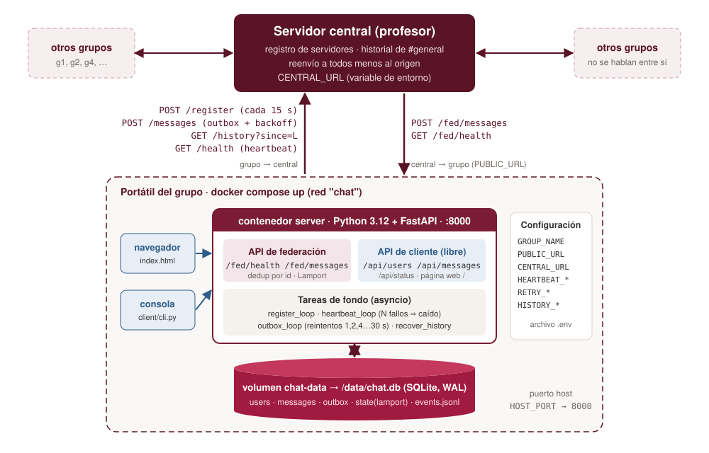

# Chat distribuido entre grupos — servidor de grupo

> 🎬 **Video de la sustentación:** https://youtu.be/VZ5T6VInjBE


Proyecto final de **Sistemas Distribuidos** (UIS · EISI).

**Integrantes:** Camilo Amaya Mora · Johen Gustavo Castañeda García · Daniel Rodriguez Anaya · Hector Felipe Higuera Jurado

Servidor de chat en contenedores que se une a la sala global `#general` a través del
servidor central del curso. Cumple los 11 requisitos del mínimo común: despliegue con
`docker compose up`, persistencia, usuarios locales, registro periódico, envío y
recepción, entrega al menos una vez con backoff exponencial y deduplicación, reloj de
Lamport, detección de fallos por heartbeat, recuperación de historial, cliente y logs.


> Documentos: [`poster/poster.pdf`](poster/poster.pdf) · [`docs/bitacora_interoperabilidad.md`](docs/bitacora_interoperabilidad.md)



---

## 1. Levantar el sistema en un equipo limpio

Requisitos: Docker Desktop (o Docker Engine) con `docker compose`. Nada más.

```bash
git clone <repo> && cd chat-distribuido
cp .env.example .env          # editar GROUP_NAME, PUBLIC_URL y CENTRAL_URL
docker compose up -d --build
```

* Cliente web: <http://localhost:8000>
* Cliente de consola: `python client/cli.py --server http://localhost:8000 --user ana`
* Logs en vivo: `docker compose logs -f server`
* Estado: <http://localhost:8000/api/status>

`PUBLIC_URL` debe ser la dirección con la que **el central** alcanza al portátil
(p. ej. `http://192.168.1.23:8000`, la IP de la red del salón; no `localhost`).
En Windows conviene permitir el puerto 8000 en el firewall.

### Laboratorio local (sin depender del servidor del profesor)

```bash
docker compose -f docker-compose.lab.yml up -d --build
```

Levanta un **central simulado** (`central-mock/`, puerto 9000) y dos servidores del
grupo, `ga` (puerto 8001) y `gb` (puerto 8002), tal como recomienda la sección 10 del
enunciado. Se usa para las pruebas, la demo y el experimento.

## 2. Variables de entorno

| Variable | Por defecto | Descripción |
|---|---|---|
| `GROUP_NAME` | — (obligatoria) | Nombre corto del grupo (`g1`, `g2`, …) |
| `PUBLIC_URL` | — (obligatoria) | URL con la que el central llama a `/fed/*` |
| `CENTRAL_URL` | — (obligatoria) | URL del servidor central. **Nunca** está en el código |
| `HOST_PORT` | `8000` | Puerto del host publicado |
| `REGISTER_INTERVAL` | `15` | s entre renovaciones de `POST /register` |
| `HEARTBEAT_INTERVAL` | `3` | s entre `GET /health` |
| `HEARTBEAT_MAX_FAILURES` | `3` | Fallos seguidos para marcar al central como caído |
| `HTTP_TIMEOUT` | `3` | Timeout de cada petición (s) |
| `RETRY_BASE` / `RETRY_MAX` | `1` / `30` | Backoff exponencial: 1, 2, 4, 8, 16, 30, 30… s (±20 % jitter) |
| `HISTORY_RECOVERY` | `true` | Pedir `GET /history` al arrancar y al volver el central |
| `HISTORY_OVERLAP` | `100` | Solapamiento en marcas de Lamport al pedir historial (`-1` = desde 0) |
| `SYNC_POLL_INTERVAL` | `0` | >0 activa sincronización periódica (anti-entropía / modo *pull*) |
| `DB_PATH` / `EVENTS_LOG` | `/data/chat.db` / `/data/events.jsonl` | Archivos en el volumen |

## 3. Estructura del repositorio

```
server/                 servidor de grupo (FastAPI)
  app/config.py         configuración por variables de entorno
  app/db.py             SQLite: usuarios, historial, outbox y reloj de Lamport
  app/federation.py     registro, heartbeat, reintentos (outbox), recuperación de historial
  app/main.py           API /fed/* (protocolo) y /api/* (cliente)
  app/events.py         log legible + log JSON de eventos
  app/static/index.html cliente web
client/cli.py           cliente de consola (solo biblioteca estándar)
central-mock/           servidor central SIMULADO para probar en local (con inyección de fallos)
conformance/            pruebas de conformidad propias + salida
experiment/             script de medición, datos (CSV), tabla y gráficas
interop/                ensayo de interoperabilidad con implementaciones ajenas
docs/                   diagrama, bitácora, guion y explicación (PDF)
poster/                 póster científico (HTML fuente y PDF)
docker-compose.yml      despliegue del grupo (sesión de interoperabilidad)
docker-compose.lab.yml  laboratorio: central simulado + ga + gb
```

## 4. Protocolo implementado

**Llamadas al central:** `POST /register`, `POST /messages`, `GET /history?since={lamport}`, `GET /health`.
**Endpoints que expone el grupo:** `GET /fed/health` → `{"server","lamport","status"}` y `POST /fed/messages`.

Formato del mensaje (idéntico al de la especificación):

```json
{"id": "6f1c2a9e-…", "from": "ana@g3", "origin": "g3", "lamport": 42,
 "sent_at": "2026-11-10T14:03:22Z", "body": "¿Ya subieron el compose?"}
```

API de cliente (libre): `POST /api/users {"name"}`, `GET /api/users`,
`POST /api/messages {"user","body"}`, `GET /api/messages`, `GET /api/status`.

## 5. Decisiones de diseño

1. **Outbox transaccional.** Al escribir un mensaje, en *una sola transacción* SQLite se
   incrementa el reloj, se guarda en el historial y se encola en `outbox`. Si el
   contenedor muere justo después, el mensaje sigue en disco y se envía al volver.
   El `payload` encolado es el JSON exacto, así el `id` nunca cambia entre reintentos.
2. **Entrega al menos una vez.** `outbox_loop` reintenta 5xx y timeouts con backoff
   exponencial con tope y *jitter* (para que los grupos no reintenten sincronizados).
   Los 4xx no se reintentan: se registran como `REJECTED`.
3. **Idempotencia del receptor.** `id` es `PRIMARY KEY`; un id repetido responde
   `200 {"status":"duplicate"}` sin tocar historial ni reloj (evento `DUPLICATE`).
4. **Reloj de Lamport persistente.** Se guarda en la tabla `state` en la misma
   transacción que el mensaje, con un candado: dos peticiones concurrentes nunca leen el
   mismo valor y el reloj nunca retrocede tras un reinicio.
   Envío: `L = L + 1`; recepción: `L = max(L, m.lamport) + 1`.
   Historial: `ORDER BY lamport, origin` (y `id` como último desempate determinista).
5. **Detector de fallos.** `heartbeat_loop` consulta `GET /health`; tras
   `HEARTBEAT_MAX_FAILURES` fallos seguidos marca al central como caído y el outbox deja
   de enviar (los mensajes se acumulan en disco). Al volver: re-registro, `GET /history`
   y liberación inmediata del outbox. Un fallo breve por debajo del umbral también
   dispara re-registro y recuperación, por si el central se reinició y nos olvidó.
6. **Recuperación con solapamiento.** Se pide `since = max_lamport_remoto − HISTORY_OVERLAP`.
   Un servidor con el reloj atrasado puede emitir mensajes con lamport *menor* que el
   nuestro; pedir exactamente desde nuestro máximo los perdería. La deduplicación hace
   que pedir de más sea inocuo.
7. **Tolerancia.** Los campos desconocidos se ignoran (`extra="ignore"`); un cuerpo
   inválido devuelve `400` (nunca 5xx, para no provocar reintentos inútiles del central).
8. **Logs en el centro.** Cada evento (`SENT`, `RETRY`, `REJECTED`, `RECEIVED`,
   `DUPLICATE`, `RECOVERED`, `CENTRAL_DOWN`, `CENTRAL_UP`, …) se escribe en una línea
   legible con id y marca de Lamport, y en `/data/events.jsonl` para el experimento.

## 6. Pruebas de conformidad

```bash
docker compose -f docker-compose.lab.yml up -d --build
python conformance/self_check.py --server http://localhost:8001 --peer http://localhost:8002 \
  --central http://localhost:9000 --restart "docker compose -f docker-compose.lab.yml restart ga"
```

Resultado actual: **24/24 pruebas pasan** (ver [`conformance/self_check_output.txt`](conformance/self_check_output.txt)).
Cuando el profesor publique el script oficial, su salida se guarda en `conformance/official_output.txt`.

## 7. Experimento: pérdidas ante una caída

```bash
python experiment/run_experiment.py      # ≈15 min: 2 modos × 3 duraciones × 3 repeticiones
python experiment/plot_results.py        # tabla (summary.md) y gráficas (losses/recovery .png/.svg)
```

Ver [`experiment/results/summary.md`](experiment/results/summary.md) y la sección del póster.

## 8. Ensayo de interoperabilidad

```bash
docker compose -f interop/docker-compose.interop.yml up -d --build
python interop/run_interop.py
```

Cuatro "grupos" contra un central simulado: dos copias del nuestro y dos implementaciones
**ajenas** (`interop/foreign/`), una correcta y otra con errores típicos. Resultados y
hallazgos en [`docs/bitacora_interoperabilidad.md`](docs/bitacora_interoperabilidad.md).

## 9. Demo sugerida (2–3 min)

```bash
docker compose -f docker-compose.lab.yml up -d --build
# abrir http://localhost:8001 (ga) y http://localhost:8002 (gb) lado a lado, crear usuarios y chatear
docker compose -f docker-compose.lab.yml logs -f ga gb      # en otra terminal: los eventos
docker compose -f docker-compose.lab.yml kill ga            # caída abrupta de ga
# seguir escribiendo desde gb …
docker compose -f docker-compose.lab.yml start ga           # ga vuelve: HISTORY_REQUEST / RECOVERED
docker compose -f docker-compose.lab.yml stop central       # el central cae: CENTRAL_DOWN, outbox crece
docker compose -f docker-compose.lab.yml start central      # CENTRAL_UP, OUTBOX_FLUSH, sin duplicados
```

## 10. Video de sustentación

[Ver en YouTube](https://youtu.be/VZ5T6VInjBE) · archivo: [video/video_final.mp4](video/video_final.mp4) (7 min 15 s).

## 11. Referencias

* Vitillo, R. *Understanding Distributed Systems* (2.ª ed.), 2022 — **libro del curso**. Parte I (cap. 2 enlaces confiables, cap. 4 descubrimiento, cap. 5 APIs), cap. 7 (detección de fallas), cap. 8 (tiempo: relojes de Lamport).
* Lamport, L. "Time, Clocks, and the Ordering of Events in a Distributed System". *CACM* 21(7), 1978.
* Enunciado y especificación OpenAPI del proyecto final, Sistemas Distribuidos, UIS, 2026.
* Documentación de FastAPI, SQLite (WAL) y Docker Compose.
